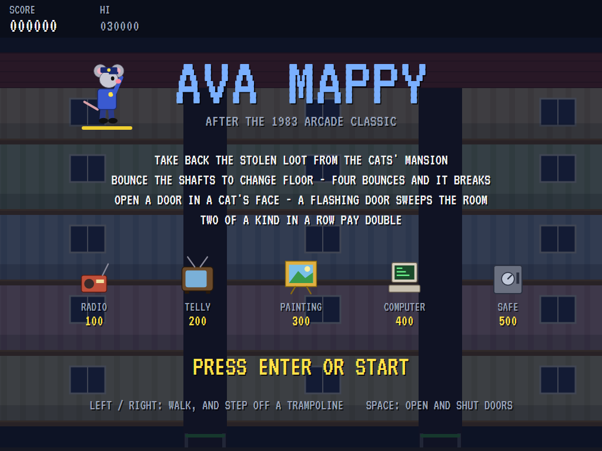
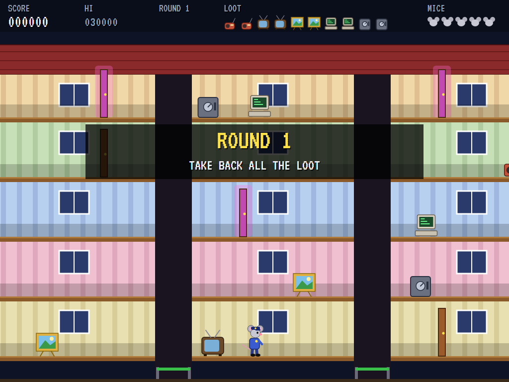
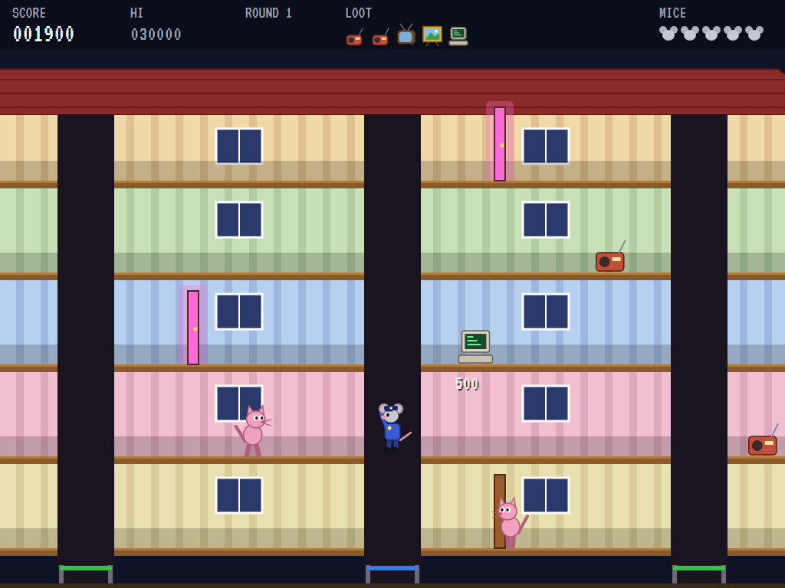
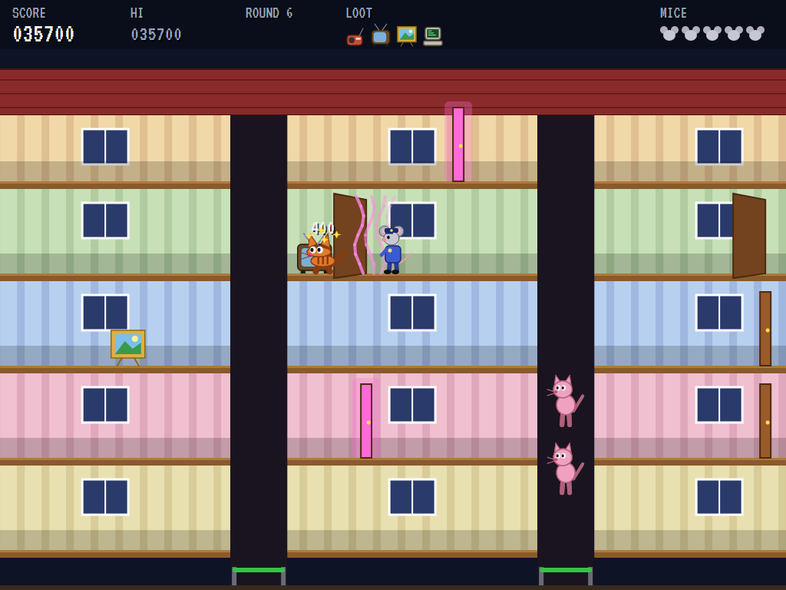
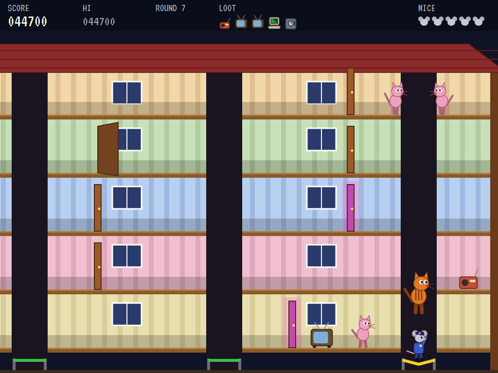
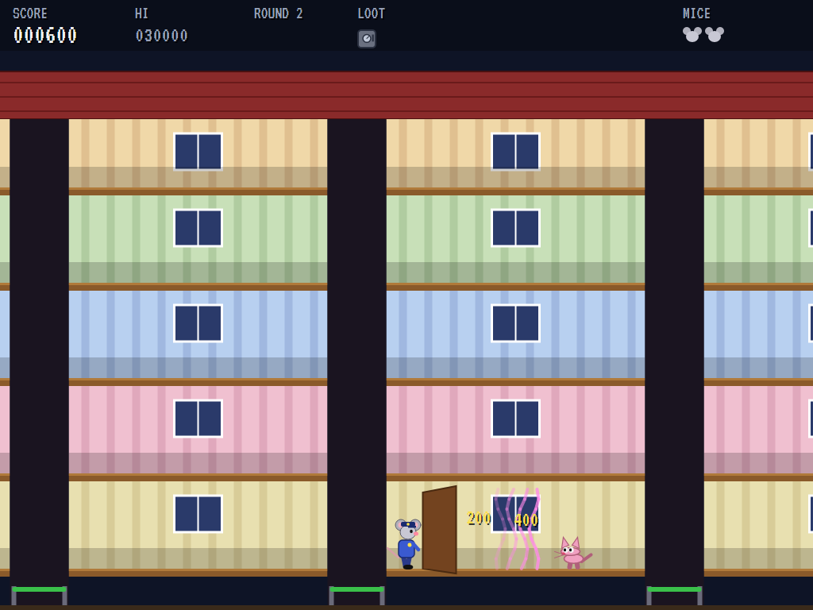
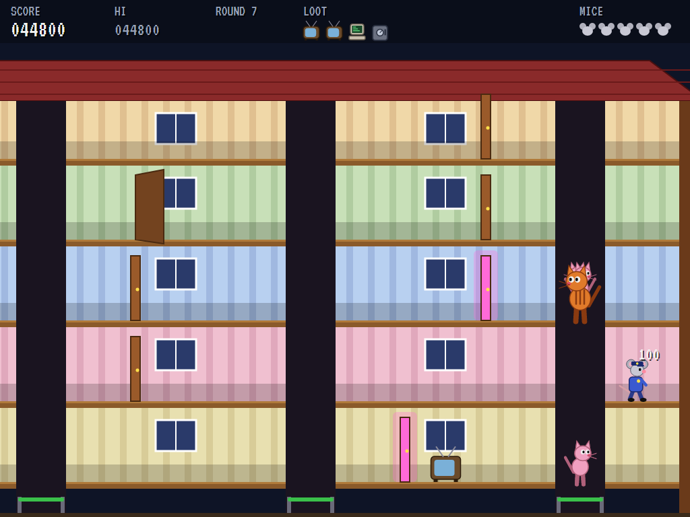
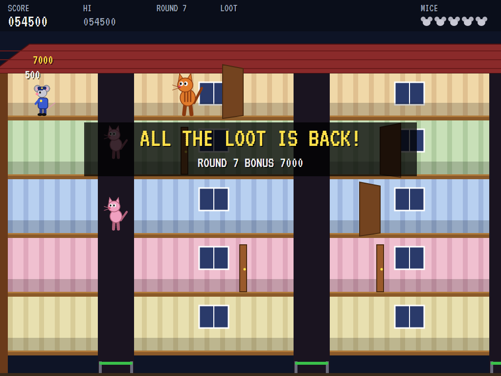
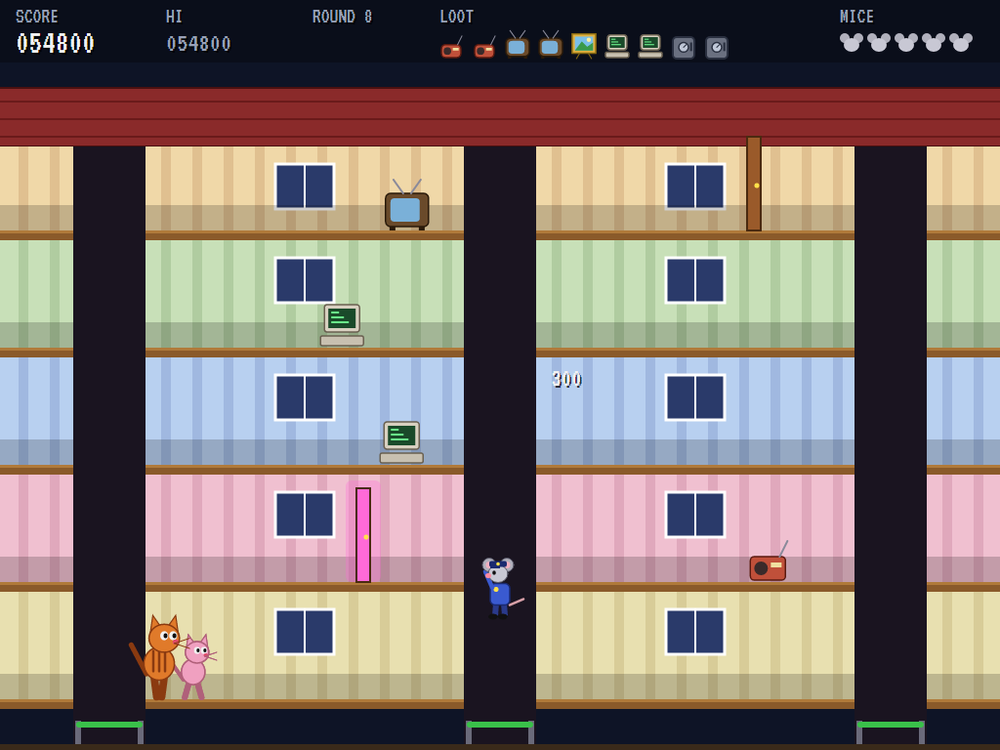
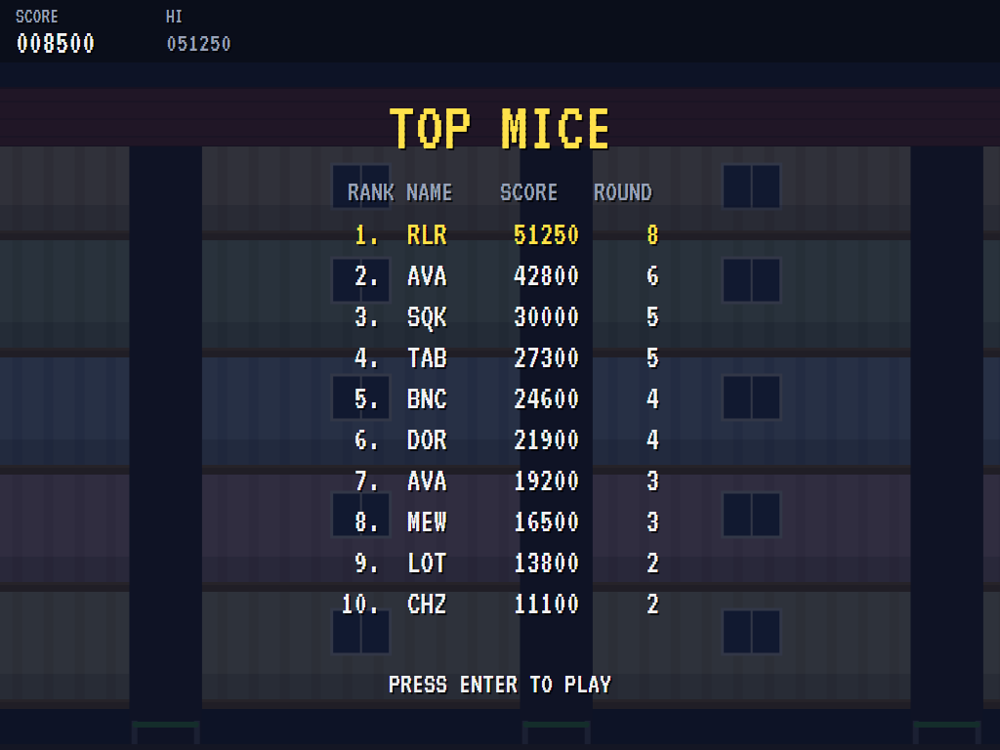

# AVA Mappy

[](https://github.com/Harlock123/AVAMappy/actions/workflows/build.yml)

A trampoline-bouncing chase in the style of Namco's 1983 arcade game **Mappy**, built with .NET 10 and
Avalonia UI. A police mouse takes back the loot the cats have stolen, all over their mansion. He goes
from floor to floor by bouncing on the trampolines in its shafts, and keeps the cats off by slamming doors
in their faces.

## Features

- **The mansion**: five floors seen in cross-section, scrolling with the mouse, and split into rooms by four trampoline shafts.
- **Bouncing**:
  - **Getting about:** the shafts are the only way between floors, or across to the next room. Walk off the edge of a room and he drops in onto the trampoline.
  - **Stepping off:** after a bounce, hold left or right as a floor goes by to step off there.
  - **Breaking:** each trampoline changes colour with every bounce in a row (green, blue, yellow, red) and breaks on the fourth.
- **Doors**: open a door in a cat's face and it's flattened for a moment. Shut doors stop cats and mice alike.
- **Power doors**: a flashing door, opened, sends a wave down the room that sweeps away every cat ahead of it, for 200, 400, 800 and up.
- **Loot**: a radio, a telly, a painting, a computer and a safe, two of each. Take them all back to clear the round. Two of the same kind in a row pay double.
- **The cats**:
  - **Chasing:** they follow the mouse through the rooms and up and down the shafts, stepping off at his floor.
  - **The Big Tabby:** from the second round, bigger and slower, and worth double.
  - **Hurry:** a round that drags on makes the cats faster.
- **Rounds**: each lays the mansion out afresh, with more cats and faster ones.
- **Scoring**:
  - Loot 100 to 500 (double for a pair), 200 for a cat flattened by a door, 200 doubling for every cat swept by a wave
  - 1,000 times the round number for clearing it
  - An extra mouse at 20,000 points and every 40,000 after that
- **Sound**: a jaunty music-hall tune with an oom-pah bass, with the boing of the trampoline, doors, flattened cats, the power door's wave, loot, the pair chime, and a trampoline snapping. All of it is synthesised and mixed by OpenAL.
- **Attract mode**: leave the title alone for 15 seconds and a computer mouse plays. It goes after the nearest loot, opens doors in cats' faces and power doors on rooms full of them, runs for a shaft when a cat closes in, and never takes a fourth bounce.
- **A top-ten high-score table** with arcade-style initials entry. It records the round reached.
- **Gamepads** through SDL2, as well as the keyboard.
- **Any window size**: the screen scales to fit, letterboxed. **Ctrl+S** saves a screenshot.
- **One self-contained executable** per platform: Windows, macOS and Linux on Intel/AMD and ARM.

## Screenshots

| The title | Round one | Bouncing |
|:---------:|:---------:|:--------:|
|  |  |  |
| What the loot is worth. | The mansion. | Up a shaft. |

| A door in its face | The trampoline | The power door |
|:------------------:|:--------------:|:--------------:|
|  |  |  |
| Flattened. | Yellow: two more and it goes. | The wave sweeps them away. |

| The chase | Round cleared | The Big Tabby |
|:---------:|:-------------:|:-------------:|
|  |  |  |
| Cats on every floor. | All the loot back. | Bigger, slower, worth double. |

| The best mice | | |
|:-------------:|:-:|:-:|
|  | | |
| The high-score table. | | |

The screenshots are made by the tests, which play the game in a real (headless) window; see
[Tests](#tests).

## Download and run

Ready-to-run builds for Windows, macOS and Linux, on both Intel/AMD and ARM, are on the
[Releases page](https://github.com/Harlock123/AVAMappy/releases/tag/latest). **Latest build** is
rebuilt on every push to `main`. Each download is one self-contained executable: no .NET install is
needed.

| Platform | Archive |
|---|---|
| Windows | `AVAMappy-win-x64.zip`, `AVAMappy-win-x86.zip`, `AVAMappy-win-arm64.zip` |
| macOS | `AVAMappy-osx-arm64.tar.gz` (Apple silicon), `AVAMappy-osx-x64.tar.gz` (Intel) |
| Linux | `AVAMappy-linux-x64.tar.gz`, `AVAMappy-linux-arm64.tar.gz`, `AVAMappy-linux-arm.tar.gz` |

```bash
tar -xzf AVAMappy-linux-x64.tar.gz     # or linux-arm64, linux-arm, osx-arm64, osx-x64
./AVAMappy
```

On Windows, unzip and run `AVAMappy.exe`. On macOS, if Gatekeeper refuses to open it, run
`xattr -d com.apple.quarantine AVAMappy` once. Run with `--no-audio` for silence.

**Sound** comes through OpenAL Soft, built in for every platform. In a virtual machine the game
detects it and uses a larger audio buffer, so the sound doesn't break up.

**Gamepads** use SDL2, which is bundled for Windows, macOS and Intel/AMD Linux. ARM Linux builds need it
installed; without it the keyboard still works:

```bash
sudo apt install libsdl2-dev            # Debian / Ubuntu / Raspberry Pi OS
sudo pacman -S --needed sdl2-compat     # Arch / Omarchy
```

## Controls

| Input | Action |
|-------|--------|
| **Enter** | Start |
| **Left** / **Right** (or **A** / **D**) | Walk; while bouncing, step off at the floor going by |
| **Space** / **Z** / **X** / **Ctrl** | Open or shut the door you're facing |
| **P** / **Esc** | Pause (Esc again to quit) |
| **M** | Mute |
| **Ctrl+S** / **Cmd+S** | Save a screenshot to the Pictures folder |

**Gamepad**: left stick or D-pad to walk, **A**, **B** or **X** for doors, **Start** to start and pause,
**Back** (while paused) to quit.

**Entering initials**: type letters, or dial with **Up**/**Down** and accept with **Space**; **Left** /
**Backspace** go back; **Enter** finishes.

## Tests

```bash
dotnet test AVAMappy.slnx
```

The engine has no UI and runs in fixed 60 Hz steps, so it plays the same at any frame rate, and a seed
always plays the same game. The tests check, mostly in an empty mansion with things placed where the
test wants them:

- **Walking and bouncing:**
  - dropping into a shaft at the end of a room
  - stepping off at a floor only after a bounce
  - the fourth bounce breaking the trampoline
- **Doors:** a shut door stopping him and opening at the button, a door flattening a cat, and a power door's wave sweeping the cats ahead for rising points
- **Cats and loot:**
  - a cat on his floor catching him, and a cat bouncing up a shaft to reach him
  - loot and the pair bonus
  - the last of the loot clearing the round, and the cats hurrying
- **Rounds and mice:** every round's ten things and its doors and power doors, the cats and the Big Tabby, a lost mouse starting again, and the last one ending the game
- **The machine:** the computer mouse clearing the first round, the attract cycle, the same game from the same seed, initials and the high-score file

The screenshot tests draw the real screen in a headless window. To refresh the README's pictures:

```bash
MAPPY_SHOTS=$PWD/Images dotnet test tests/AVAMappy.Tests --filter ScreenshotTests
```

To see how the computer mouse gets on, round by round (for tuning):

```bash
MAPPY_PROBE=1 dotnet test tests/AVAMappy.Tests --filter PilotProbe --logger "console;verbosity=detailed"
```

## Building

```bash
dotnet build AVAMappy.slnx
dotnet run --project src/AVAMappy
```

Needs the .NET 10 SDK. The sounds are made by `tools/make_sounds.py` (standard-library Python):
`python3 tools/make_sounds.py` rewrites `src/AVAMappy/Sounds`.

## Project structure

```
AVAMappy/
├── AVAMappy.slnx
├── src/AVAMappy/
│   ├── Engine/
│   │   ├── GameEngine.cs        # States, the title and demo cycle, and the music
│   │   ├── GameEngine.Play.cs   # Walking, bouncing and the trampolines, doors and power doors, the cats,
│   │   │                        # loot and pairs, rounds and scoring
│   │   ├── MousePilot.cs        # The computer mouse, for the demonstration (and the tests)
│   │   ├── Entities.cs          # The mansion's floors, rooms and shafts, and everything in them
│   │   ├── HighScoreTable.cs, InitialsEntry.cs
│   │   ├── InputHandler.cs, ControllerManager.cs  # Keys and an SDL2 gamepad
│   │   └── SoundManager.cs      # Effects, the tune and the jingles through OpenAL
│   ├── Audio/                   # The OpenAL engine (from the author's AVABand)
│   ├── Views/                   # The mansion, the mouse, the cats, the loot, and the screens
│   └── Sounds/                  # The synthesised effects and tunes
├── tests/AVAMappy.Tests/        # Gameplay, screenshot and probe tests
├── tools/make_sounds.py
└── Images/                      # Screenshots
```

## About and licence

AVA Mappy © 2026 Lonnie Watson, under the [MIT License](LICENSE).

*Mappy* © 1983 Namco; the name belongs to its current owner. AVA Mappy is an independent, unofficial game
in its style. Its mouse, cats, mansion, loot, graphics, sounds, tunes and code are its own; nothing is
taken from the arcade machine's program, graphics, sound or music. It is not affiliated with or endorsed
by any rights holder.
